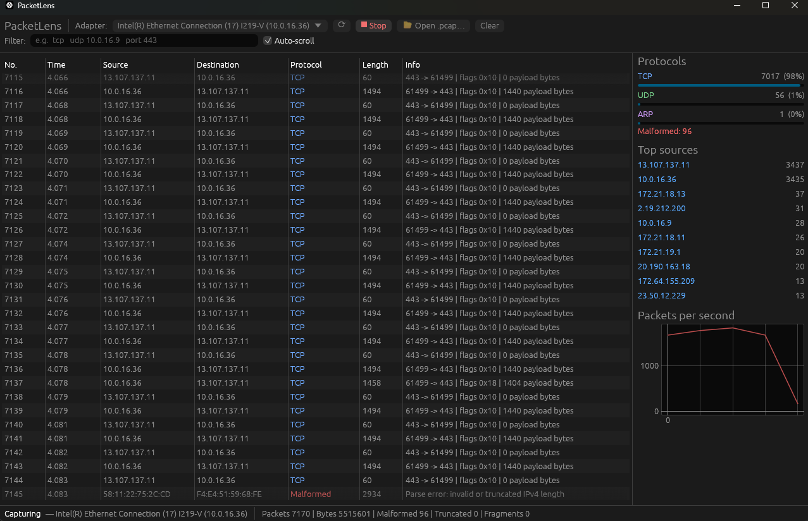

# PacketLens
Rust packet analyzer for Ethernet/IPv4: a dependency-free CLI for offline PCAP files, with optional live capture (Npcap/libpcap) and an egui desktop window.



## Run
Install Rust using rustup. From this directory:

```sh
cargo run -- analyze captures/sample.pcap --verbose
cargo test
cargo build --release
```

The synthetic capture contains one TCP, one UDP and one ICMP packet (180 captured bytes total). No real user traffic is included. Classic PCAP, Ethernet link type only; Wireshark can export classic PCAP rather than PCAPNG. Analyze only captures you are authorized to inspect.

## Architecture
`src/lib.rs` contains PCAP reading and Ethernet, IPv4 and transport parsing. `src/stats.rs` decodes each packet into a summary and keeps the running statistics shared by the CLI (`src/main.rs`, `src/live.rs`) and the desktop window (`src/bin/gui.rs`). Each parser validates lengths before indexing and borrows payload slices. PCAP records are read one at a time, with a 16 MiB per-record allocation cap.

## Limitations
No IPv6 decoding, fragment reassembly, checksum validation, encrypted payload decoding or full protocol conformance validation. Truncated capture records are counted separately from malformed packets. The malformed count reflects structural parsing checks, not proof of malicious traffic. Outgoing packets captured before Large Send Offload splits them can exceed the MTU and carry an IPv4 total length of 0; PacketLens then uses the captured length instead of counting them as malformed. Source-address statistics grow with unique addresses. The sample is synthetic; performance and accuracy on real traffic are not benchmarked.

## Live capture (v1.1)

Offline commands still work without native capture libraries. For live capture, install Npcap and its SDK on Windows (https://npcap.com/#download), then extract the SDK into this directory as `npcap-sdk-<version>` (git-ignored) or set `$env:NPCAP_SDK` to its folder; `build.rs` adds the right `Lib` folder to the linker path. On Fedora install `libpcap-devel` and `pkgconf-pkg-config`.

```
cargo run --features live -- interfaces
cargo run --features live -- live 1 100 --verbose
```

Choose the actual adapter number from the list. The capture stops after 100 packets (or your specified count) or 30 seconds, whichever comes first. It uses non-promiscuous mode and does not write captures to disk. Capture only on networks and devices you are authorized to monitor. IPv6 is identified but not decoded; only Ethernet link types are supported. Live capture requires native driver permissions. Tests: `cargo test` and `cargo test --features live`.

## Desktop window (optional)

A desktop window built with egui, behind the `gui` feature (which includes `live`, so it needs the same Npcap setup):

```
cargo run --features gui --bin packetlens-gui
cargo build --release --features gui --bin packetlens-gui
```

Pick an adapter (one that is up and has an IPv4 address is preselected) and press **Start capture**, or **Open .pcap…** to view a capture file. The window shows a live packet table, a details pane with decoded headers and a hex dump for the selected packet, protocol and top-source summaries, and a packets-per-second chart. The filter box ANDs its terms: protocol names (`tcp`, `arp`), address fragments (`10.0.16.9`) and `port 443`. The table keeps the most recent 100,000 packets; the statistics count all of them. Live capture in the window runs until you press Stop.

The window uses DirectX 12, Vulkan or Metal, not OpenGL, which crashed on some Windows drivers. Set `WGPU_BACKEND` (e.g. `dx12`, `vulkan`, `gl`) to override.
